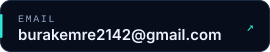

  

  Software engineer building complete web products — from the database schema and the API to the interface people actually use.

## About Me

I enjoy owning a product end to end: modelling the data, designing the API contract and shipping a fast, accessible interface on top of it. Most of my work is in the .NET ecosystem — C# and ASP.NET Core — paired with React, Next.js and TypeScript on the front end and PostgreSQL or SQL Server underneath. I care about clean architecture and secure-by-default APIs, and when a product benefits from it, I bring it to life with real-time 3D using Three.js and WebGL.

- **Backend** — REST APIs with ASP.NET Core and Entity Framework Core: validation, authentication, authorization.
- **Front end** — React and Next.js with TypeScript: server rendering, accessible components, responsive layouts.
- **Data** — relational modelling and migrations on PostgreSQL and SQL Server.
- **3D on the web** — Three.js and WebGL scenes with fallbacks and reduced-motion support.

## Tech Stack

  
  
  
  
  
  

## GitHub Statistics

  
  

Built every day from the GitHub GraphQL API by this repository's own workflow — no third-party image services.

## Contribution Snake

<picture>
  <source media="(prefers-color-scheme: dark)" srcset="https://raw.githubusercontent.com/BURAKEMREF/BURAKEMREF/output/snake-dark.svg">
  <source media="(prefers-color-scheme: light)" srcset="https://raw.githubusercontent.com/BURAKEMREF/BURAKEMREF/output/snake-light.svg">
  
</picture>

Redrawn every day from my contribution graph with <a href="https://github.com/Platane/snk">Platane/snk</a>.

## Featured Projects

  
  

Most of my recent work lives in private repositories, so it is not listed here.

## Contact

  
  

